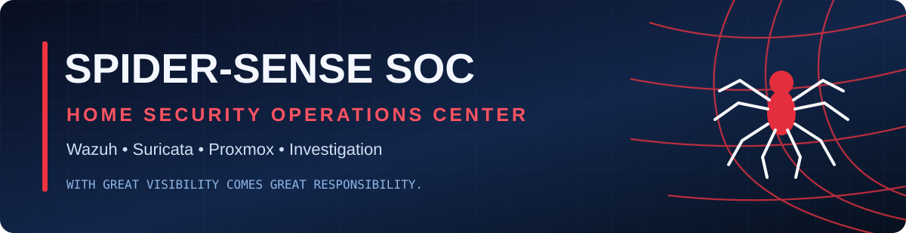
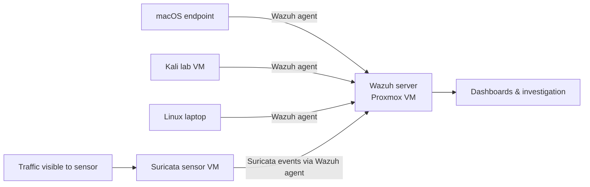
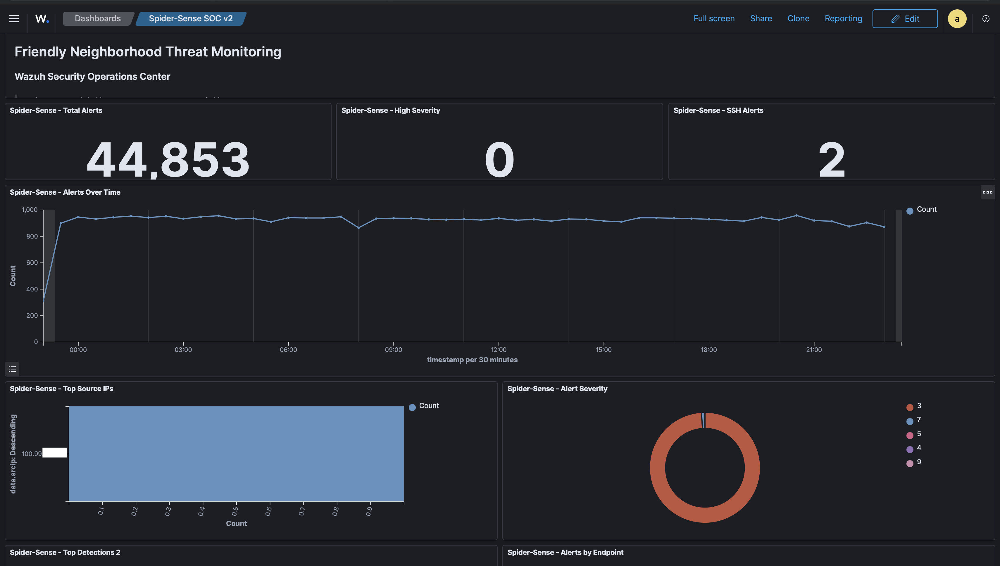
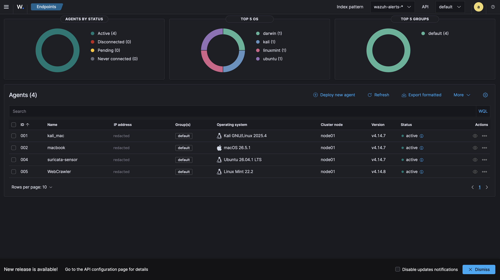
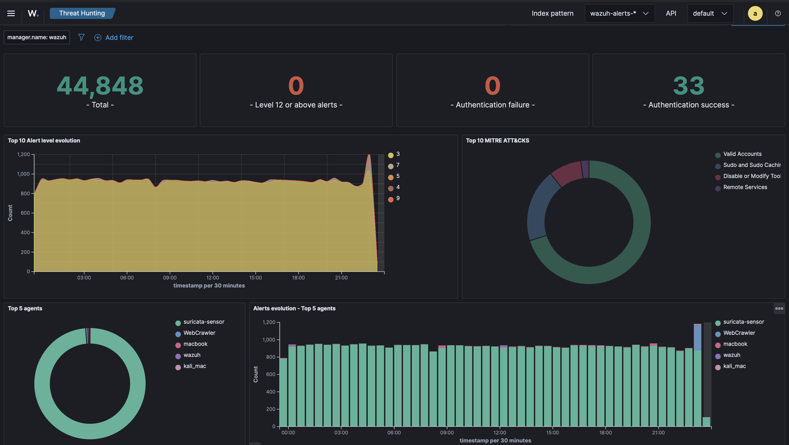
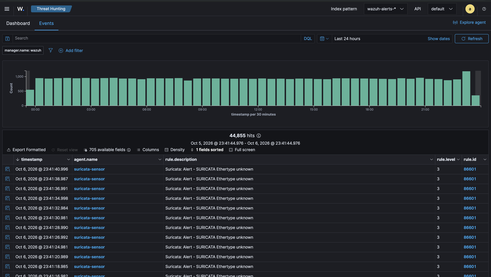

  

# Spider-Sense SOC 🕷️

**A hands-on home Security Operations Center using Wazuh, Suricata, and Proxmox.**

[Architecture](architecture/architecture.md) · [Investigation 001](investigations/001-listening-port-changes.md) · [Investigation workflow](docs/investigation-workflow.md) · [Detection roadmap](docs/detection-roadmap.md) · [Investigation template](docs/investigation-template.md) · [Lab safety](docs/lab-safety.md)

## Why I built it

I wanted to move from reading about SIEMs and IDS tools to operating them: collecting endpoint telemetry, understanding network alerts, troubleshooting visibility, and documenting defensible investigations.

## System overview

| Component | Role |
| --- | --- |
| Proxmox VE host (`homeweb`) | Hosts the security monitoring VMs |
| SpiderSense VM | Central Wazuh server for security telemetry and alerts |
| Suricata sensor VM | Network IDS with a Wazuh agent forwarding sensor events |
| MacBook, Kali VM, Linux laptop (`webcrawler`) | Monitored endpoints / lab systems |

**Visibility caveat:** The Suricata interface is attached to the Proxmox `vmbr0` bridge. This **does not** establish full visibility into every packet on the home network. See the [architecture notes](architecture/architecture.md).

## Evidence from the lab

| SOC dashboard | Monitored endpoints |
| --- | --- |
|  |  |

| Threat hunting | Suricata events |
| --- | --- |
|  |  |

Dashboard event counts are **telemetry volume, not verified incidents or confirmed attacks**. Private LAN IP addresses are redacted from the screenshots.

## Investigation: changing listening ports

[Investigation 001](investigations/001-listening-port-changes.md) documents a Wazuh alert for changing listening TCP/UDP ports on a monitored MacBook.

- Compared snapshots with `diff -u`.
- Inspected currently active ports and processes using `lsof` and `ps`.
- Verified Tailscale activity on UDP 41641, but **did not** attribute the historical alerting ports to Tailscale.
- **Disposition: inconclusive.** The ports had closed before process attribution could be established.
- **Engineering takeaway:** Preserve timestamped process-to-port history so future alerts can be investigated retrospectively.

This is an example of recording uncertainty rather than claiming a false positive or compromise without supporting evidence.

## Repository map

- [`architecture/`](architecture/) — Design and data flow
- [`investigations/`](investigations/) — Evidence-based case notes
- [`docs/investigation-workflow.md`](docs/investigation-workflow.md) — Repeatable analyst checklist
- [`docs/detection-roadmap.md`](docs/detection-roadmap.md) — Gaps and planned improvements
- [`screenshots/`](screenshots/) — Dashboard evidence

## Skills demonstrated

SIEM deployment and administration · IDS integration · Endpoint monitoring · Linux and virtualization · Log triage · Network visibility analysis · Investigation documentation · Security engineering tradeoffs

## Status and next steps

**Working homelab; ongoing development.** Next steps include historical process/port telemetry, improved sensor coverage, reproducible sanitized configuration examples, and additional documented investigations. Planned work is not presented as already deployed.

## Security and ethics

The lab is for authorized monitoring and testing. Do not commit credentials, API tokens, private keys, internal addresses, or unsanitized logs. Screenshots and example data should be reviewed for sensitive details before publishing.
